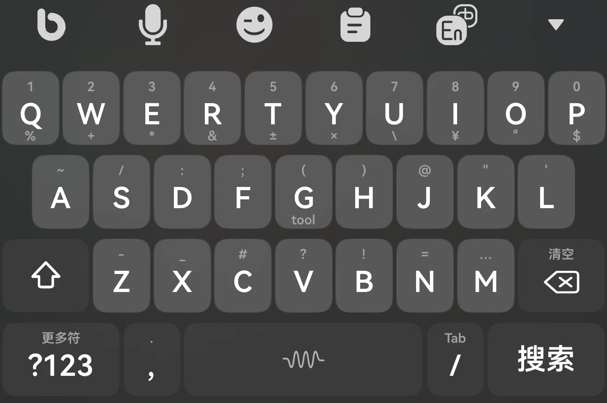

<div align="center">

# 小鹤万象Pro · 超越输入法主题

**鸿蒙 NEXT ｜ 基于开源 Rime 引擎的「超越输入法」· 自用小鹤万象Pro 键盘主题**

[⬇️ 超越输入法 · 应用市场下载](https://appgallery.huawei.com/app/detail?id=app.flytype.hmos.bim&channelId=SHARE)

<sub>📌 本分支 <code>小鹤万象Pro（超越）</code> 是 <b>小鹤万象Pro</b> 版；音形版见 main 分支，双拼版见 <code>小鹤双拼（超越）</code>，九宫格万象版见 <code>小鹤万象Base（超越）</code>，万象 number 版见 <code>小鹤万象number（超越）</code></sub>

</div>

<p align="center">
  
</p>

## ✨ 主题特性

- 🔢 **首排上滑数字** —— `Q`–`P` 上滑直接出 `1`–`0`，下滑出符号；长按候选里同样带数字，全键盘不用切页打字
- 🌈 **26 键主键盘 + 独立数字页** —— 主键盘 35 键四行满宽，数字页走九宫格 + 符号表，两种输入习惯随时切换
- 🧰 **长按即用** —— 长按字母出「数字 / 全角标点 / 反查」，长按 `，` 出 `，。！？：@……` 再反查
- 📏 **紧凑布局** —— 横向键距 `2`、纵向键距 `6`（横屏 `3`）、圆角 `8`，键帽更大更好按
- 🎨 **自制矢量图标** —— `res/` 里 5 个 svg 覆盖语音、表情、剪贴板、中英切换
- 🕶️ **无阴影键帽** —— `shadow` 全 0，配合自带配色更干净

## ⌨️ 键盘布局

### 字母页 `default`（35 键）

| 行 | 内容 |
| :-- | :-- |
| 顶栏 | 语音识别 · 表情 · 剪贴板 · 中英切换 |
| 1 | `Q W E R T Y U I O P` —— 上滑 `1`–`0`，下滑 `% + * & ± × \ ¥ ° $`，长按数字 / 大写 |
| 2 | `A S D F G H J K L` —— 上滑 `~ / : ; ( ) @ " '`；`G` 下滑打开工具面板（全选 / 剪切 / 复制 / 粘贴 / 清空 / 重建主题） |
| 3 | `Shift`（1.5 键宽）+ `Z X C V B N M` + `⌫`（1.5 键宽，上滑清空全部、下滑撤销） |
| 4 | `?123`(2) · `，`(1) · `空格`(4，上滑切英文、双击「。」) · `/`(1，上滑 Tab) · `回车`(2，上滑剪贴板) |

> 第 4 行 = `20 + 10 + 40 + 10 + 20 = 100` 份，正好 10 个字母键宽，与前三行同宽。
>
> `?123` 直接切符号页，上滑切「更多符号」页，长按弹出设置菜单。
>
> `，` 长按可打出 `，。！？：@……`，最后一项是反查。

### 英文页 `english`

- 首排上滑同样输入数字 `1`–`0`，与中文页保持同一手感（英文页不带下滑符号）
- 第 4 排：`?123`(2) · `,`(1) · `space`(4，上滑切回中文) · `/`(1) · `return`(2)

### 数字页 `number`（20 键）

- 左侧符号表（`+ - × / % = , # ? . : *`），右侧九宫格 `1`–`9`、`0`
- 四行各 100 份：`1 2 3` + `⌫` ／ `4 5 6` + `空格` ／ `7 8 9` + `@` ／ `符` · `返回` · `0` · `.` · `回车`
- `⌫` 上滑清空全部、下滑撤销；`@` 用 `send_at` 直接上屏字面量

## 🚀 导入方法

1. 下载本分支（`Code` → `Download ZIP`，或 `git clone -b 小鹤万象Pro（超越）`）
2. 把主题文件夹 `小鹤万象Pro（超越）` 压缩成 `.zip`
3. 打开超越输入法 → 主题 → 导入，选择该 zip 即可

> `theme.yaml` 通过相对路径 `./../public/...` 继承输入法内置的公共资源（样式、字体、配色、公共按键、数字页菜单），请勿改动目录层级与这些路径。
>
> `themes_data/bottom_func_keys.yaml` 必须跟着主题一起导入——`?123` 键的上下文行为（切符号页 / 有候选时上半角逗号 / 编码中反查）定义在这里。

## 🎛️ 常用旋钮

| 字段 | 位置 | 现值 | 作用 |
| :-- | :-- | :-- | :-- |
| `horizontal_gap` | `theme.yaml:72` | `2` | 横向键距，调小 → 键变宽 |
| `vertical_gap` | `theme.yaml:73` | `6` | 纵向键距（横屏 `vertical_gap_land: 3`） |
| `height` / `height_land` | `theme.yaml:70-71` | `46` / `34` | 竖屏 / 横屏键高 |
| `round_corner` | `theme.yaml:75` | `8` | 键帽圆角 |
| `width` | `theme.yaml:145` | `10` | 键盘宽 = 10 个字母键宽 |
| `shadow` | `theme.yaml:93` | 全 `0` | 键帽阴影，改 `radius`/`offsetY` 可加回立体感 |

## 📁 目录结构

```
Beyond-theme/                       # 分支 小鹤万象Pro（超越）
├─ 小鹤万象Pro.png                  # 效果图（26 键主键盘实机截图）
├─ SECURITY.md
├─ README.md
└─ 小鹤万象Pro（超越）/             # 主题文件夹（导入时选这个文件夹压成的 zip）
   ├─ info.yaml                     # 主题元信息（name / version / author）
   ├─ theme.yaml                    # 键盘与配色主体
   ├─ res/                          # 自制图标：yy 语音 · bq 表情 · jt 剪贴板 · To_Zh / To_En 中英切换
   └─ themes_data/
      └─ bottom_func_keys.yaml      # 「?123」键的上下文行为
```

## 📝 更新记录

### 2026-11-05

- **建立分支** `小鹤万象Pro（超越）`：把新的万象 Pro 主题（3 套键盘、35 / 35 / 20 键）纳入仓库，README 按实际布局编写
- **加上效果图** `小鹤万象Pro.png`（实机截图 1316×875，26 键主键盘页），README 顶部按 88% 宽度展示

---

<sub>适配超越输入法 5.4 ｜ 主题 `小鹤万象Pro` v1.0.0 ｜ 作者 `_647Uni` ｜ 平台 `hmos`</sub>
