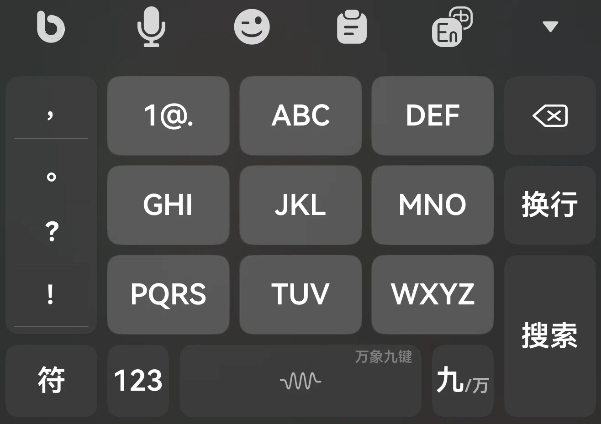
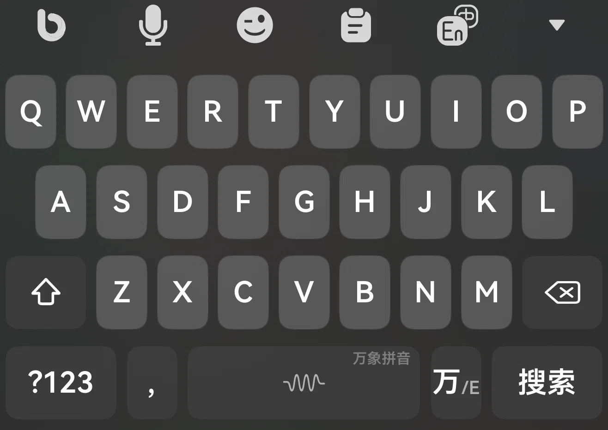

<div align="center">

# 小鹤万象 · 超越输入法主题

**鸿蒙 NEXT ｜ 基于开源 Rime 引擎的「超越输入法」· 自用小鹤万象键盘主题（九宫格 + 全键盘）**

[⬇️ 超越输入法 · 应用市场下载](https://appgallery.huawei.com/app/detail?id=app.flytype.hmos.bim&channelId=SHARE)

<sub>📌 本分支 <code>小鹤万象（超越）</code> 是 <b>小鹤万象</b> 版；音形版见 <a href="https://github.com/zghnby0825/Beyond-theme/tree/main">main 分支</a>，双拼版见 <code>小鹤双拼（超越）</code> 分支</sub>

</div>

<p align="center">
  
  
</p>

## ✨ 主题特性

- 🔀 **九宫格 / 全键盘双布局** —— 九宫格页按 `九/万` 一键切到全键盘，全键盘页按 `万/E` 切回中文；切换同时联动 Rime 方案（`wanxiang` / `wanxiang_t9` / `wanxiang_english`）
- 🔢 **数字上滑 + 符号下滑**（全键盘页）—— `Q`–`P` 上滑输入 `1`–`0`，下滑输入 `% + * & ± × \ ¥ ° $`
- 👆 **长按候选** —— 九宫格长按出该数字组的字母（`4` → `GHI`），全键盘长按出数字 / 大写 / 全角字符
- 🧩 **九宫格专属底栏** —— 左侧 11 个常用标点竖排；`1@.` 下滑发 `Ctrl+Del`；`123` 是上下文键（正常切数字页、编码中打半角逗号、下滑开定制工具栏）
- 📏 **紧凑布局** —— 九宫格横向键距 6 / 纵向 10，全键盘每键 10 份，键帽大、四角圆润
- 🎨 **自制矢量图标** —— 语音识别 / 表情 / 剪贴板 / 中英切换，任何分辨率都清晰
- 🌑 **无阴影键帽** —— 纯色键帽 + 圆角 8，界面干净利落
- ⌨️ **六套键盘页** —— `default`（九宫格）· `wx_keyboard`（全键盘）· `english` · `number` · `symbols` · `handwriting`

## ⌨️ 键盘布局

### 九宫格页 `default`

| 行 | 内容 |
| :-- | :-- |
| 顶栏 | 语音识别 · 表情 · 剪贴板 · 中英切换 |
| 1 | 左侧标点表 `，。？！~、；：@…'`（11 个，占 17 份）+ `1@.`（下滑 `Ctrl+Del`）+ `2 ABC` + `3 DEF` + `⌫`（上滑向右清、下滑撤销） |
| 2 | 空档 + `4 GHI` + `5 JKL`（下滑工具面板：全选 / 剪切 / 复制 / 粘贴 / 清空 / 重建主题）+ `6 MNO` + `下一候选` |
| 3 | 空档 + `7 PQRS` + `8 TUV` + `9 WXYZ` + `换行`（长按清空·撤销·重做·下一候选） |
| 4 | `符`(1.7) · `123`(1.2) · `空格`(4.2，上滑切英文) · `九/万`(1.2，长按设置板 / 斜杠 / 换主题) |

> 九宫格数字键各 22 份、标点表与 `⌫` 各 17 份 → 前三行 = `17 + 22 × 3 + 17 = 100` 份，正好铺满；第 4 行 = `17 + 12 + 42 + 12 = 83` 份，与官方九宫格主题同构（上三行贴满、底栏稍窄）。

### 全键盘页 `wx_keyboard`

| 行 | 内容 |
| :-- | :-- |
| 1 | `Q W E R T Y U I O P` —— 上滑 `1`–`0`，下滑符号，长按候选 |
| 2 | `A S D F G H J K L` —— 上滑 `~ / : ; ( ) @ " '`，右侧留 5 份空档；`G` 下滑工具面板 |
| 3 | `Shift`(1.5) + `Z X C V B N M` + `⌫`(1.5，上滑清空、下滑撤销) |
| 4 | `?123`(2) · `，`(1) · `空格`(4) · `万/E`(1) · `搜索`(2) |

> 第 4 行 = `20 + 10 + 40 + 10 + 20 = 100` 份，与官方原版一致。`万/E` 按下会一起做两件事：切到英文键盘页 + 切到 `wanxiang_english` 方案。

### 英文页 `english`

- 与全键盘页同构（`ascii_mode: 1`、`lock: true`），第 1 排上滑同样是数字 `1`–`0`
- 第 4 排：`?123`(2) · `,`(1) · `space`(4) · `万/E`(1) · `return`(2)

### 数字页 `number` / 符号页 `symbols`

- `number`：左侧符号表（`+ - × / % = , # ? . : *`）+ 九宫格数字 `1`–`9`、`0`，附空格、句点、删词与回车
- `symbols`：数字键长按出变体（`1` → `一 壹 ① ⑴ ⒈ ❶ ㊀ ㈠`），第二行起是标点集合（`~ / : ; ( ) @ " '` 等），`?123` 系的完整符号页

### 手写页 `handwriting`

- 整段继承输入法公共页（`./../public/preset_keyboards/default:/preset_keyboards/handwriting`），主题里不重复定义

## 🚀 导入方法

1. 下载本分支（`Code` → `Download ZIP`，或 `git clone -b 小鹤万象（超越）`）
2. 把主题文件夹 `小鹤万象（超越）` 压缩成 `.zip`
3. 打开超越输入法 → 主题 → 导入，选择该 zip 即可

> `theme.yaml` 通过相对路径 `./../public/...` 继承输入法内置的公共资源（样式、字体、配色、公共按键、数字页菜单），请勿改动目录层级与这些路径。
>
> 主题文件夹 2026-10-22 由 `小鹤双拼主题（超越）` 改名为 `小鹤万象（超越）`；双拼版在 `小鹤双拼（超越）` 分支，音形版在 `main` 分支。

## 🎛️ 想自己改？

布局参数按页分别写在 `小鹤万象（超越）/theme.yaml` 的 `preset_keyboards:` 下：

| 参数 | 作用 | 九宫格 `default` | 全键盘 `wx_keyboard` / `english` |
| :-- | :-- | :-- | :-- |
| `width` | 键盘宽度（= 单键宽的倍数） | `22` | `10` |
| `height` / `height_land` | 键高（竖屏 / 横屏） | `46` / `34` | `46` / `34` |
| `horizontal_gap` | 按键横向间距（调小 → 键更宽） | `6` | `6`（继承公共） |
| `vertical_gap` | 行间距（横屏为 `vertical_gap_land`） | `10` | `10`（继承公共） |
| `round_corner` | 键帽圆角 | `8` | `8` |
| `shadow` | 键帽阴影（当前全 0，即无阴影） | `0` | `0` |

每个按键都支持 `swipe_up`（上滑）、`swipe_down`（下滑）、`long_click`（长按候选）。行内 `width` 是相对份数：九宫格数字键 22 份、字母键 10 份、`Shift` / `⌫` 15 份，一整行合计 100 份即正好铺满键盘宽度。

```yaml
# 九宫格数字键：上滑候选、长按出字母、下滑动作
- { click: 5, label: JKL, swipe_up: commit_5, swipe_down: eisu_toggle_tool,
    long_click: [ commit_j, commit_k, commit_l, commit_5, commit_J, commit_K, commit_L ] }
```

## 📁 目录结构

```
Beyond-theme/                          # 分支 小鹤万象（超越）
├─ 小鹤万象（超越）/
│  ├─ info.yaml                        # 主题信息（名称 / 作者 / 版本）
│  ├─ theme.yaml                       # 核心：键盘布局 + 样式 + 配色 + 字体 + 自定义按键
│  ├─ res/                             # 图标：yy 语音 · bq 表情 · jt 剪贴板 · To_Zh / To_En 中英切换
│  └─ themes_data/
│     ├─ t9_keys.yaml                  # 九宫格 `1@.` 键（含 4 个字母候选）
│     └─ bottom_func_keys.yaml         # 底栏 `123` 上下文键（本地定义，自带半角逗号分支）
├─ 小鹤万象1.png                       # 效果图 · 九宫格页
├─ 小鹤万象2.png                       # 效果图 · 全键盘页
└─ README.md
```

## 📝 更新记录

### 2026-10-23

- **新增九宫格 + 全键盘双布局**：`default` 为 T9 九宫格（`width: 22`）、`wx_keyboard` 为 QWERTY 全键盘，两页互切并联动 Rime 方案
- **九宫格底栏**：标点竖排 11 项、`1@.` 下滑发 `Ctrl+Del`、`123` 上下文键（正常→数字页 / 编码中→半角逗号 / 下滑→定制工具栏）、`九/万` 一键切全键盘
- **`preset_keys` 重排**：新增 `eisu_toggle_schema_wanxiang` / `wanxiang_t9` / `wanxiang_english` 与三个组合键（`{a}{b}` 宏）
- **新增符号页** `symbols`：数字长按变体 + 完整标点集合
- **`themes_data` 恢复**：`t9_keys.yaml`（`1@.`）+ `bottom_func_keys.yaml`（本地 `bottom_123_key`），不再依赖公共片段
- **效果图换成两张实机图**：`小鹤万象1.png`（九宫格）、`小鹤万象2.png`（全键盘）

### 2026-10-22

- **仓库改名**：`HarmonyNEXT_Rime_input_647Uni` → `Beyond-theme`（GitHub 旧链接自动跳转，分支与 Releases 不受影响）
- **新建万象版分支** `小鹤万象（超越）`（内容从 `小鹤双拼（超越）` 复制）；主题文件夹 `小鹤双拼主题（超越）` → `小鹤万象（超越）`，`info.yaml` 名称改为「小鹤万象」
- **效果图改名** `小鹤双拼.png` → `小鹤万象.png`

### 2026-10-20

- **第 4 行宽度再调**：符号 `22` / 逗号 `10` / 空格 `43` / 回车 `25`（合计仍 `100` 份；空格加宽、逗号收窄）
- **更换效果图**（原名 `小鹤双拼.png`）：实机截图（首排上滑数字 + 下滑符号、`?123` 更多符、`，` 上滑「。」），旧 `小鹤音形.png` 随之更名

### 2026-10-19

- **建立双拼版分支** `小鹤双拼（超越）`；主题文件夹 `小鹤主题（超越）` → `小鹤双拼主题（超越）`，`info.yaml` 名称改为「小鹤双拼主题」，版本 `1.0.0` → `1.1.0`
- **第 4 行精简为 4 键**：去掉 `；` 键与 `themes_data/bottom_func_keys` 引用，改为 `?123`(22) · `，`(13) · `空格`(40) · `回车`(25)
- **第 4 行宽度收回到 100 份**：符号 22 / 逗号 13 / 空格 40 / 回车 25（此前一度是 105 与 102，会顶出屏幕）
- **横向键距 `2 → 4`**，`width: 10` 提到键盘块首
- **英文页空格上滑**由 `eisu_toggle_ABC_english` 改回 `eisu_toggle_Zh_default`（切回中文）
- `?123` 改为直接切符号页、上滑「更多符号」页，长按弹通用设置 / 重建主题（长按去掉了「主题设置」项）

### 2026-10-11

- **首排对调**：`Q`–`P` 上滑改为数字 `1`–`0`，下滑改为符号 `% + * & ± × \ ¥ ° $`（长按候选同步换成数字），英文页一并同步
- **布局收紧**：横向键距 `6 → 2`、纵向键距 `10 → 6`、横屏行距 `4 → 3`、圆角 `18 → 8`，键帽更大
- **新增数字页** `number`：九宫格数字 + 符号表；左侧符号表键高微调至 `153`
- **细节修正**：`，` 键上滑统一为 `.`；`；` 键去掉重复的 `swipe_up`，`name` 由 `slash` 改为 `semicolon`
- **更新效果图**
- **文件夹改名**：`小鹤主题_0904` → `小鹤主题`（音形版，`main` 分支）
- **发布 Release `v.1011`**（音形版）：附带打包好的 `xhyx_1011.zip`

### 2026-09-04

- 首次发布，适配超越输入法 5.4

---

<sub>适配超越输入法 5.4 ｜ 主题 `小鹤万象` v1.1.0 ｜ 作者 `_647Uni` ｜ 平台 `hmos`</sub>
