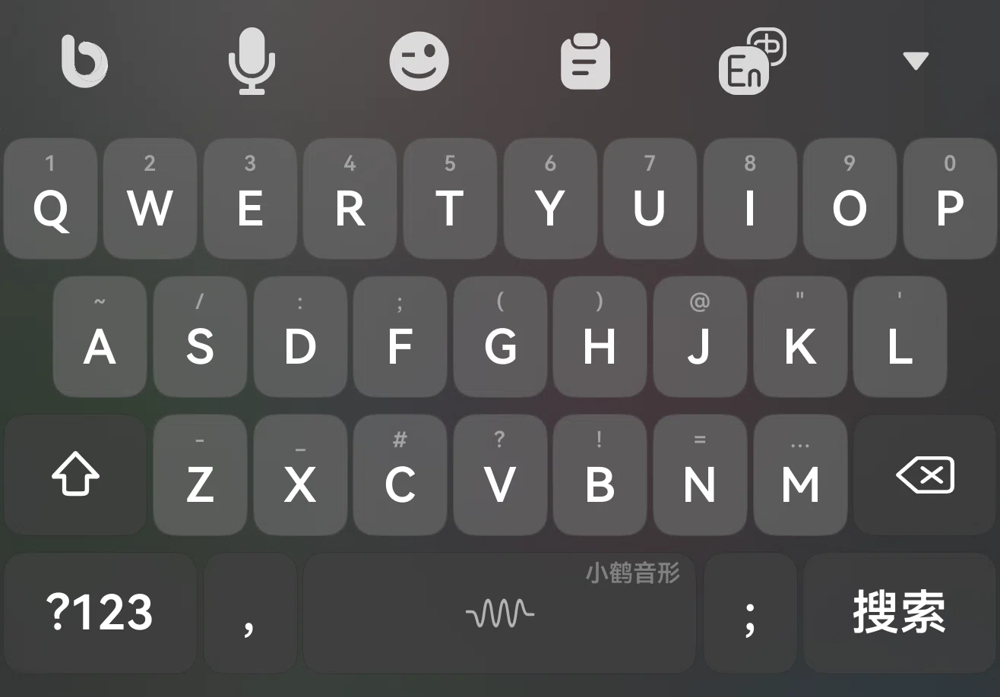

<div align="center">

# 小鹤双拼 · 超越输入法主题

**鸿蒙 NEXT ｜ 基于开源 Rime 引擎的「超越输入法」· 自用小鹤双拼键盘主题**

[⬇️ 超越输入法 · 应用市场下载](https://appgallery.huawei.com/app/detail?id=app.flytype.hmos.bim&channelId=SHARE)

<sub>📌 本分支 <code>小鹤双拼（超越）</code> 是 <b>小鹤双拼</b> 版；音形版见 <a href="https://github.com/zghnby0825/HarmonyNEXT_Rime_input_647Uni/tree/main">main 分支</a></sub>

</div>



## ✨ 主题特性

- 🔢 **数字上滑** —— `Q`–`P` 上滑即输入 `1`–`0`，不用切数字页（中英两页一致）
- ➗ **符号下滑** —— 中文页同一排下滑输入 `% + * & ± × \ ¥ ° $`
- 👆 **长按候选** —— 长按弹出该键的候选（数字 / 大写 / 全角字符等）
- 📏 **紧凑布局** —— 横向键距 4、纵向键距 6、横屏行距 3，键帽更大更好按；四行宽度都恰好铺满屏幕
- ⌨️ **三套键盘页** —— 中文 `default`、英文 `english`、数字符号 `number`
- 🎨 **自制矢量图标** —— 语音识别 / 表情 / 剪贴板 / 中英切换，任何分辨率都清晰
- 🌑 **无阴影键帽** —— 纯色键帽 + 圆角 8，界面干净利落

## ⌨️ 键盘布局

### 中文页 `default`

| 行 | 内容 |
| :-- | :-- |
| 顶栏 | 语音识别 · 表情 · 剪贴板 · 中英切换 |
| 1 | `Q W E R T Y U I O P` —— 上滑 `1`–`0`，下滑符号，长按候选 |
| 2 | `A S D F G H J K L` —— 上滑 `~ / : ; ( ) @ " '`；`G` 下滑打开工具面板（全选 / 剪切 / 复制 / 粘贴 / 清空 / 重建主题） |
| 3 | `Shift`（1.5 键宽）+ `Z X C V B N M` + `⌫`（1.5 键宽，上滑清空全部、下滑撤销） |
| 4 | `?123`(2.5) · `，`(1) · `空格`(4，上滑切英文、双击「。」) · `搜索 / 回车`(2.5，上滑剪贴板，长按清空·撤销·重做·下一候选) |

> 第 4 行 = `25 + 10 + 40 + 25 = 100` 份，正好 10 个字母键宽，与前三行同宽。
>
> `?123` 直接切符号页，上滑切「更多符号」页，长按弹出设置菜单。
>
> `，` 长按可打出 `，。！？：@……`。

### 英文页 `english`

- 第 1 排上滑同样输入数字 `1`–`0`，与中文页保持同一手感（英文页不带下滑符号）
- 第 4 排：`?123`(2.5) · `,`(1) · `space`(4，上滑切回中文、双击「。」) · `return`(2.5)

### 数字页 `number`

- 左侧符号表（`+ - × / % = , # ? . : *`）+ 九宫格数字 `1`–`9`、`0`，附空格与回车
- 右下 `⌫` 上滑清空全部、下滑撤销；左下「符」切符号页、`返回` 回中文页

## 🚀 导入方法

1. 下载本分支（`Code` → `Download ZIP`，或 `git clone -b 小鹤双拼（超越）`），或直接用打包好的 `小鹤双拼主题_1019.zip`
2. 把主题文件夹 `小鹤双拼主题（超越）` 压缩成 `.zip`
3. 打开超越输入法 → 主题 → 导入，选择该 zip 即可

> `theme.yaml` 通过相对路径 `./../public/...` 继承输入法内置的公共资源（样式、字体、配色、公共按键、数字页菜单），请勿改动目录层级与这些路径。
>
> 主题文件夹 2026-10-19 由 `小鹤主题（超越）` 改名为 `小鹤双拼主题（超越）`；音形版的同名文件夹在 `main` 分支。

## 🎛️ 想自己改？

常用旋钮都在 `小鹤双拼主题（超越）/theme.yaml` 的 `preset_keyboards:` 下：

| 参数 | 作用 | 当前值 |
| :-- | :-- | :-- |
| `horizontal_gap` | 按键横向间距（调小 → 键更宽，整行仍铺满屏幕） | `4` |
| `vertical_gap` | 行与行之间的纵向间距（横屏为 `vertical_gap_land`） | `6`（横屏 `3`）|
| `height` / `height_land` | 键高（竖屏 / 横屏） | `46` / `34` |
| `round_corner` | 键帽圆角 | `8` |
| `width` | 键盘宽度（= 字母键宽的倍数） | `10` |
| `shadow` | 键帽阴影（当前全 0，即无阴影） | `0` |

每个按键都支持 `swipe_up`（上滑）、`swipe_down`（下滑）、`long_click`（长按候选），例如：

```yaml
- { click: q, label: "Q", swipe_up: "1", swipe_down: "%", long_click: [ "1", commit_q, commit_Q ] }
```

行内 `width` 是相对份数：字母键 10 份、`Shift` / `⌫` 15 份，一整行合计 100 份即正好铺满键盘宽度。

## 📁 目录结构

```
HarmonyNEXT_Rime_input_647Uni/          # 分支 小鹤双拼（超越）
├─ 小鹤双拼主题（超越）/
│  ├─ info.yaml                        # 主题信息（名称 / 作者 / 版本）
│  ├─ theme.yaml                       # 核心：键盘布局 + 样式 + 配色 + 字体
│  ├─ res/                             # 图标：yy 语音 · bq 表情 · jt 剪贴板 · To_Zh / To_En 中英切换
│  └─ themes_data/
│     └─ bottom_func_keys.yaml         # 早期「?123」上下文键定义，当前布局未引用（保留备用）
├─ 小鹤音形.png                        # 效果图
└─ README.md
```

## 📝 更新记录

### 2026-10-19

- **建立双拼版分支** `小鹤双拼（超越）`；主题文件夹 `小鹤主题（超越）` → `小鹤双拼主题（超越）`，`info.yaml` 名称改为「小鹤双拼主题」，版本 `1.0.0` → `1.1.0`
- **第 4 行精简为 4 键**：去掉 `；` 键与 `themes_data/bottom_func_keys` 引用，改为 `?123`(25) · `，`(10) · `空格`(40) · `回车`(25)
- **第 4 行宽度收回到 100 份**：符号 25 / 逗号 10 / 空格 40 / 回车 25（此前一度是 105 与 102，会顶出屏幕）
- **横向键距 `2 → 4`**，`width: 10` 提到键盘块首
- **英文页空格上滑**由 `eisu_toggle_ABC_english` 改回 `eisu_toggle_Zh_default`（切回中文）
- `?123` 改为直接切符号页、上滑「更多符号」页，长按弹设置菜单

### 2026-10-11

- **首排对调**：`Q`–`P` 上滑改为数字 `1`–`0`，下滑改为符号 `% + * & ± × \ ¥ ° $`（长按候选同步换成数字），英文页一并同步
- **布局收紧**：横向键距 `6 → 2`、纵向键距 `10 → 6`、横屏行距 `4 → 3`、圆角 `18 → 8`，键帽更大
- **新增数字页** `number`：九宫格数字 + 符号表；左侧符号表键高微调至 `153`
- **细节修正**：`，` 键上滑统一为 `.`；`；` 键去掉重复的 `swipe_up`，`name` 由 `slash` 改为 `semicolon`
- **更新效果图**
- **文件夹改名**：`小鹤主题_0904` → `小鹤主题`（音形版，`main` 分支）
- **发布 Release `v.1011`**（音形版）：附带打包好的 `xhyx_1011.zip`

### 2026-09-04

- 首次发布，适配超越输入法 5.4

---

<sub>适配超越输入法 5.4 ｜ 主题 `小鹤双拼主题` v1.1.0 ｜ 作者 `_647Uni` ｜ 平台 `hmos`</sub>
